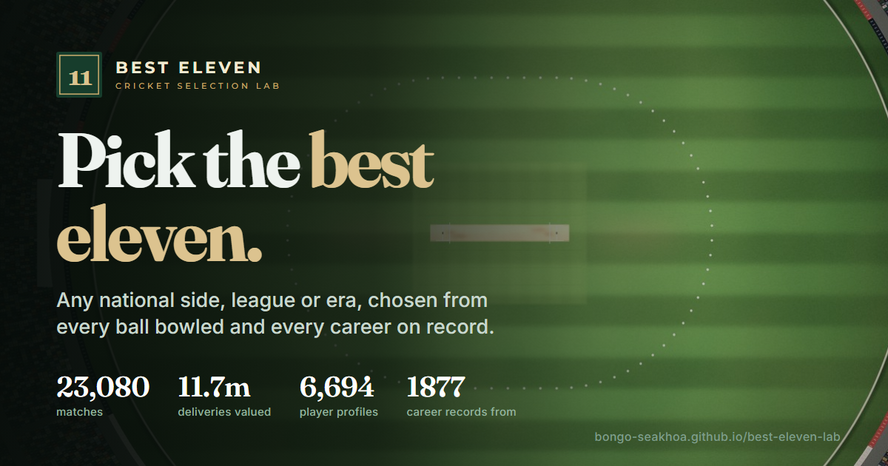

<p align="center"></p>

# Best Eleven · cricket selection lab

Pick a cricket Best XI for any national side, franchise league or era, from every ball in [Cricsheet](https://cricsheet.org)'s archive and every international career on record since 1877.

**Live site: https://bongo-seakhoa.github.io/best-eleven-lab/**

- **Best XI.** Choose men's or women's Tests, ODIs or T20Is, or a league (IPL, SA20, BBL, PSL, CPL, WPL, WBBL and nine more). Pick a team or a World XI, a year window, and who is available: the current squad, active players or everyone. Then weigh quality, legacy, experience and leadership as you see fit. An exact solver returns the best eleven for that composition, with the captain, keeper, next in line, "why not X?" and a robustness check.
- **All eras.** A second evidence base built from complete career records (Tests from 1877, ODIs from 1971), adjusted to each decade's average, so Bradman, Barry Richards or Graeme Pollock can sit alongside today's players.
- **Player profiles** for 6,707 cricketers. Each shows ratings, season trends, how the player fares against each bowling type or batting type, by phase, how they get out (or take wickets) compared with their peers, the bowlers or batters they meet most, and a field plan built from their measured rates.
- **Player database** that knows who is actually available: current national and franchise squads, reported retirements and come-backs, captaincy and vice-captaincy, batting hand, bowling style and career totals.
- **Captains** compared side by side from formal captaincy records. Every captain with a Cricsheet id or a Wikipedia article links to a page: a full profile, or a career record for those who played before ball-by-ball coverage.
- **Pages remember where you were.** Each of Best XI, Players, Captains and XI vs XI keeps its last state in your browser, the back and forward buttons return to it, and links to the pages you used last point left or right the way they sit in the menu.
- **XI vs XI.** Pick two elevens from any formats or leagues, in the Best XI's shape or a free one (all batters against all bowlers, if you like), swap players in and out, and play them as a Test, ODI or T20I: projected runs per innings, where the gap comes from, and win chances calibrated on real matches. The default is the Test World XI against the T20I World XI in an ODI.
- **Short records handled properly.** A debutant or a thin record is pulled towards what the player's other cricket predicts, through format-to-format transitions measured on players who played both, not towards an average player.

## How it works

```
Cricsheet all_json.zip ─► ingest ─► Parquet warehouse (23,132 matches, 11.7 m deliveries)
                                         │
Wikipedia / Wikidata ─► enrich ─► data/reference (players, squads, captaincy, careers, team images)
                                         │
                       model ─► run expectancy ─► value of every ball ─► opposition / era / venue
                                adjustment (ridge) ─► season aggregates ─► bowling-type classifier
                                         │
                       validate ─► margins, career totals, out-of-sample check, classifier CV
                                         │
                       export ─► site/data (JSON) ─► static site: selection runs in your browser
                                         │
                       calibrate ─► XI vs XI win chances fitted on real matches, checked on later ones
```

Every limited-overs ball is valued by how much it changes the batting side's expected total. The run-expectancy surface is fitted by era, with a Duckworth–Lewis-style curve per wickets lost. In Tests, a ball is worth its runs minus each dismissal priced at that year's runs per wicket. A ridge regression on batter, bowler, both sides and context (era × phase × innings × home) then removes who a player faced and where. Empirical-Bayes shrinkage keeps short records from dominating. The selector turns your weights into one score per player per slot and solves the assignment exactly as a min-cost flow. That solver is checked against an integer program on every test run. [docs/METHODOLOGY.md](docs/METHODOLOGY.md) has the details.

## Checks on every build

| Check | Latest result |
|---|---|
| Winning margins rebuilt from deliveries | 99.96% of 10,015 run margins and 99.99% of 10,364 wicket margins exact |
| Career totals vs Wikipedia (strict set: careers wholly inside coverage, infoboxes fresh at the snapshot, Cricsheet counted to each infobox's date) | 93 Test players, 100% exact on matches, runs and wickets |
| Earlier rating vs later output (Spearman, batters) | adjusted beats raw in Tests 0.64 vs 0.60, ODIs 0.45 vs 0.40, T20Is 0.35 vs 0.31, IPL 0.40 vs 0.35 |
| Pace/spin classifier (5-fold CV) | 89% accuracy, AUC 0.965; labels kept only above 0.85 confidence (94% accurate) |
| Debut priors on 2019–26 debutants (fitted before 2019) | Beat the old average-player prior in all ten judged formats and disciplines, e.g. men's T20I batting error 0.197 vs 0.329, women's T20I batting 0.303 vs 0.812 |
| XI vs XI win chances on 2021–26 matches (fitted to 2020) | Brier beats the naive forecast in all six calibrated groups: men's Tests 0.581 vs 0.613, ODIs 0.218 vs 0.249, T20Is 0.225 vs 0.250, T20 leagues 0.244 vs 0.249; women's ODIs 0.160 vs 0.249, T20Is 0.186 vs 0.250 |

The Pages workflow refuses to publish if a check fails. [docs/ASSURANCE.md](docs/ASSURANCE.md) records what was verified and what remains open.

## Run it yourself

Python 3.11+ and Node.js 18+ (for `select`, and for the XI vs XI calibration inside `build`).

```bash
python -m pip install -e ".[dev]"
best-eleven fetch            # Cricsheet archive and people register (conditional download)
best-eleven build            # ingest, model, validate, export, calibrate (about 15 minutes)
best-eleven serve --open     # the site on http://127.0.0.1:8765
best-eleven select --scope men-test --team "South Africa" --availability squad
best-eleven enrich           # refresh the Wikipedia/Wikidata snapshots (network, ~20 minutes)
pytest -q
```

`select` accepts `--scope` (`men-test`, `women-odi`, `ipl`, `sa20`, …), `--from`/`--to`, `--preset` (`balanced`, `quality`, `form`, `legacy`, `experience`), `--availability`, `--max-per-team`, `--max-overseas` and `--json`.

## Automation

- **Tests** run on every push: Python, plus a parity check of the browser solver against SciPy's MILP.
- **Build and publish the site** runs on every push to `main` and every Monday. It downloads Cricsheet's latest archive, rebuilds everything, validates, and deploys to GitHub Pages.
- **Refresh the player database** is manual. It re-reads Wikipedia and Wikidata and opens a pull request, so squad, retirement and captaincy changes are reviewed before they reach the site.

## Repository

```
src/best_eleven/   ingest, enrich/ (Wikipedia, Wikidata, team images), model/, validate, export, cli
site/              index.html and assets: engine/ (selection), views/, ui/ (charts, icons), css/
data/reference/    versioned player-database snapshots; data/raw, warehouse and model are rebuilt
config/            competitions, league overseas rules with their sources
scripts/           render_grounds.py: renders the ground images behind field plans and the hero
site/assets/img/   rendered grounds, team flags and logos (with credits), brand mark
tests/             network-free tests and fixtures
```

## Limits worth knowing

- Cricsheet withholds matches involving Afghanistan's men, and men's ball-by-ball coverage starts around 2002.
- No ball-tracking or shot data exists, so field plans set the number of catchers, ring and boundary fielders from measured rates, while exact positions follow convention.
- Squads, retirements and captaincy come from Wikipedia and can lag. Overseas status is inferred from international appearances.

## Credits and licence

Match data from [Cricsheet](https://cricsheet.org) (ODC-By 1.0). Player attributes, squads, captaincy and historic careers from Wikipedia and Wikidata (CC BY-SA 4.0 / CC0). Team flags from Wikimedia Commons; franchise logos belong to their owners and are shown only to identify teams. This is a non-commercial fan project, not affiliated with any board, league or franchise. See [DATA_NOTICE.md](DATA_NOTICE.md) and the site's Credits page. Code: MIT.
